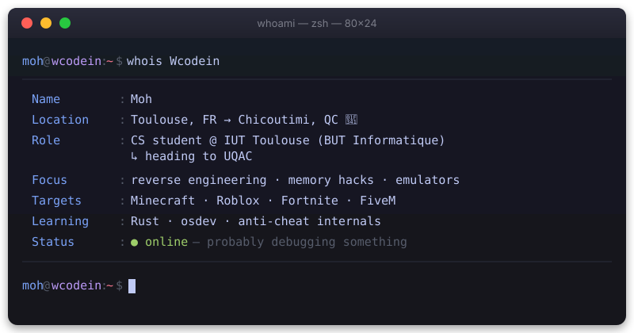

  

---

### ⚔️ Arsenal

**Languages**

**Workbench**

**Reverse Engineering**

### 📊 Stats

 

### 📈 Activity

### 🐍 Contribution Snake

<picture>
  <source media="(prefers-color-scheme: dark)" srcset="https://raw.githubusercontent.com/Wcodein/Wcodein/output/github-snake-dark.svg" />
  <source media="(prefers-color-scheme: light)" srcset="https://raw.githubusercontent.com/Wcodein/Wcodein/output/github-snake.svg" />
  
</picture>

---

 

<em>"it's not a bug — it's a feature flag, in memory."</em>

